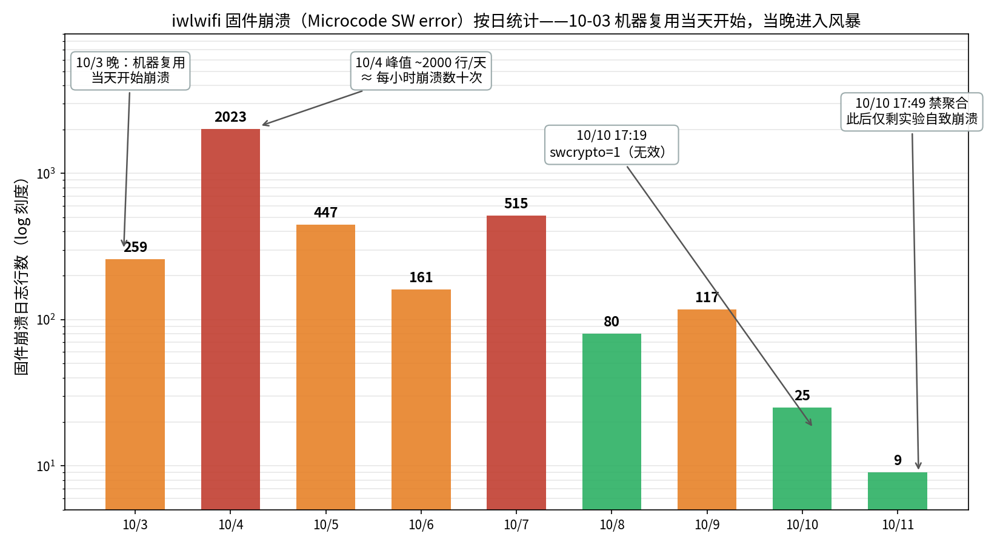
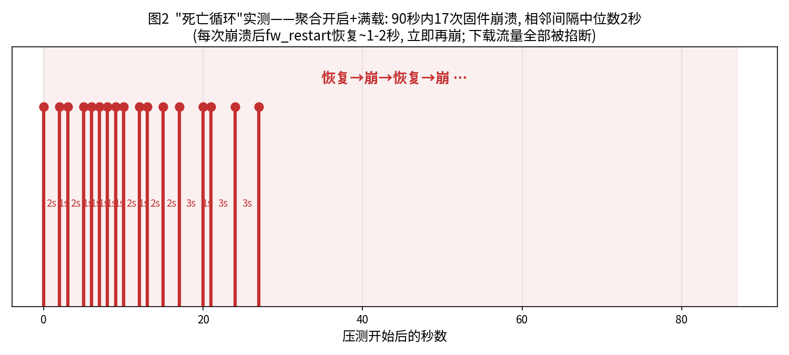
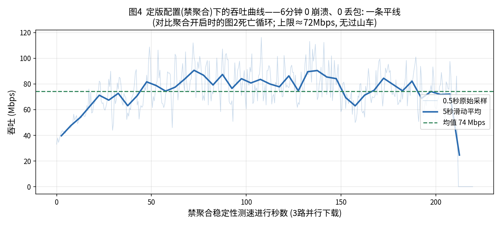
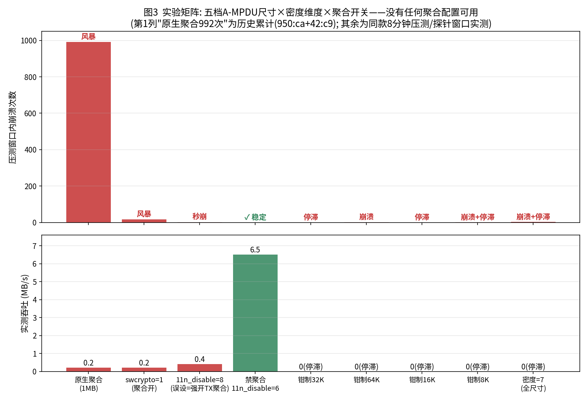

# 一台 XPS13 的 Wi-Fi 频繁断网排查记：问题出在固件，解法是关聚合

> 机器：Dell XPS 13 L322X（2013，i7-3517U）
> 网卡：Intel Dual Band Wireless-AC 7260，固件 iwlwifi-7260-17.ucode
> 系统：Ubuntu 22.04 HWE，内核 6.8.0-138-generic，iwlwifi + iwlmvm
> 路由器：小米 AX6000（Wi-Fi 6，2.4G + 5G）
> 排查时间：2026-10-10 ~ 10-11（背后还有 10-06 ~ 10-09 的第一轮，见时间线）

先说结论：断网是网卡固件崩了。`Microcode SW error detected`，全历史日志里这个错误有 3636 条〔证据: microcode-sw-error-all.txt〕。固件是闭源的，上游最后一次内容更新停在 2018-10-03〔5〕，所以修是修不了的，只能让它少干活：把聚合关掉，`options iwlwifi 11n_disable=6`。代价是吞吐从纸面 867 Mbps〔1〕掉到实测 74 Mbps，换来零崩溃。

为什么是这个参数、怎么证明的、中间踩了什么坑，下面从头记一遍。关键结论后面都跟了〔证据: 文件名〕，外部资料的原文页面我下载存在 `ref/` 里（[1]~[6]，文末有清单）。

### 时间线

| 阶段 | 时间 | 做了什么 | 结果 |
|---|---|---|---|
| 风暴 | 10-03 起 | 机器闲置三年半后重新用，断流越来越频繁，靠手动开关 Wi-Fi 续命 | 10-04 峰值约 2000 行崩溃日志/天（图 1） |
| 第一轮排查 | 10-06 ~ 10-09 | 各种软件参数轮流试（省电、bt_coex、11n_disable=8、swcrypto），都没用；怀疑卡坏，买了块全新同型号 7260HMW 换上，20 分钟崩 316 次；10-09 做 AP 对照实验，结论反转 | 卡没问题。问题出在"AX6000 × 7260 固件"这个组合 |
| 第二轮排查（本文） | 10-10 ~ 10-11 | 找到两轮都漏掉的正确参数 11n_disable=6；把死亡循环量化；把聚合的档位试穷；顺手修了 Ubuntu 头文件的 BTF 坑 | 禁聚合是唯一能用的解，74 Mbps 稳定运行 |

两轮排查是分开做的，互相不知道对方，最后从不同方向走到了同一个地方。

---

## 一、先把"6G 不兼容"排掉

第二轮开始的时候，我手里有个现成的假设：网卡和小米路由器 6G 不兼容。这是听来的说法，没有出处。但它有个可以马上检验的前提——这块卡到底有没有 6GHz。

```text
$ lspci -nn | grep -i network                     〔证据: ref/logs/lspci.txt〕
01:00.0 Network controller [0280]: Intel Corporation Wireless 7260 [8086:08b1] (rev 73)

$ iw phy                                          〔证据: ref/logs/iw-phy.txt〕
    Band 1:   (2.4 GHz)
    Band 2:   (5 GHz)                             ← 就两个频段，没有 6GHz
```

Intel 官方规格页也是这么写的：AC 7260，802.11ac 双频，2.4 GHz 和 5 GHz，最高 867 Mbps，整页没有 6GHz 这个词〔1〕。作为对比，有 6GHz 的 AX210 规格页上明确标着 Wi-Fi 6E 和 6 GHz〔2〕。

所以这个假设不成立：2013 年的卡，物理上没有 6GHz 射频，碰不到那个频段。

顺带说一句，`can not stop rx aggregation` 不是什么罕见报错。它出自内核 `net/mac80211/agg-rx.c` 第 91 行〔3〕，本机崩溃时就打印过〔证据: can-not-stop-rx-agg-all.txt〕。网上别的案例出现同一行字，不代表是同一个病，还是得回自己的日志里找。

## 二、崩溃长什么样：一天 2023 次

固件崩溃的主签名：

```text
kernel: iwlwifi 0000:01:00.0: Microcode SW error detected.  Restarting 0x2000000.
kernel: iwlwifi 0000:01:00.0: Start IWL Error Log Dump:        (固件寄存器转储)
kernel: wlp1s0: HW problem - can not stop rx aggregation for a4:a9:30:e2:76:da tid 0/2/4/6
```

全历史统计：`Microcode SW error` 共 3636 行〔证据: microcode-sw-error-all.txt〕，按天分布见图 1：10/3=259，10/4=2023，10/5=447，10/6=161，10/7=515，10/8=80，10/9=117，10/10=25，10/11=9。



有三个时间点值得注意：

1. 崩溃始于 10/3，机器重新启用的当天。启动历史显示 2023-02-01 之后到 2026-10-03 21:42 之间没有开机记录〔证据: boot-history.txt〕，开机当晚就崩上了〔证据: daily-crash-counts.txt〕；
2. 崩溃跨内核：10/3~10/5 跑的是 5.15，之后是 6.8，两边都崩〔证据: boot-history.txt〕——跟内核版本没关系；
3. 为什么 10/3 才开始崩，我说不清。可能是机器闲置三年半出了问题，可能是路由器那边变了——现在对端是 Wi-Fi 6 的 AX6000，聚合行为跟老的 AC 路由器不一样，而 2021 年短暂使用时没有崩溃记录。这个问题我留着没下结论，因为后面的结论不依赖它：只依赖剂量关系（第六节）和 AP 归因（第四节）。

这里得认个错。普查的时候我写了 `journalctl -g -i '...'`——journalctl 根本没有 `-i` 选项〔6〕，命令直接失败返回空，我以为自己查出了"38 次启动零固件错误"。下午实时监控抓到崩溃后回头复核才发现命令是错的，真实数字是 `can not stop rx aggregation` 共 992 行〔证据: can-not-stop-rx-agg-all.txt〕。

这件事给我留了条规矩：凡是"没查到"，先拿一条已知存在的记录验证命令本身。

## 三、其他断线原因

把一周内的断线事件挨个归因，剩下的都有主：

| 现象 | 原因 | 证据 |
|---|---|---|
| 断线成串爆发（某晚 6~10 次） | gnome-shell 的 rfkill 开关，也就是手动开关 Wi-Fi 抢救 | off/on 成对事件 20 条，`audit: op="radio-control" ... uid=1000`，时间和断线对得上〔证据: rfkill-user-toggles.txt〕 |
| 重连后自动挂到 2.4G 变慢 | NetworkManager 里两个连接同优先级，按信号百分比挑 | 激活记录：HomeNet_5G 62 次 / HomeNet 16 次〔证据: nm-activation-counts.txt〕 |
| 接口"消失又出现" | 手动 `modprobe -r iwlmvm iwlwifi`（前期调试） | sudo 审计日志 8 条〔证据: sudo-audit-debug-actions.txt〕 |
| 偶尔被踢下线（reason=0） | AP 发起（`CTRL-EVENT-DISCONNECTED` 没有 `locally_generated=1`） | 原始 wpa_supplicant 日志 |

## 四、992 次崩溃，全发生在小米的两个电台上

这是整个排查里我最看重的一组证据。每条聚合失败日志都带着当时所连 AP 的地址：

```text
$ journalctl -g 'can not stop rx aggregation for' | grep -oE 'for [0-9a-f:]{17}' | sort | uniq -c
    950 for a4:a9:30:e2:76:da    ← 小米路由 5G
     42 for a4:a9:30:e2:76:d9    ← 小米路由 2.4G     〔证据: bssid-attribution.txt〕
```

992 次，100% 在小米路由上。同一时期这张卡也连过另一个 AP 组（00:be:75:*），那边只有 PTK 重钥告警，一次固件崩溃都没有〔证据: ptk-rekey-warnings.txt〕。

所以结论要收着说：这是"这块卡 + 这个 AP"的组合问题，不能推广成"这块卡 + 聚合"。到这一步也只能说明跟 AP 有关，换路由器有没有用，得试了才算数。

### 换一张全新的同型号卡，照样崩

第一轮排查（10-06 ~ 10-09）走过一段弯路：当时判断"故障在卡内部"，于是买了全新同型号 Intel 7260HMW（半高 mini-PCIe，正常安装识别）。装上后带载测试 20 分钟，崩了 316 次（10-07）——换卡这个方案当场作废。

10-09 又用这张卡做了 AP 对照：连 X1C 热点 10 分钟，0 崩溃；连小米 AX6000 10 分钟，崩 31~34 次。插槽、供电、主机侧因素一并排除。

到这里是个 2×2：新旧两块卡 × 两个 AP，崩不崩只看 AP。买新卡替换为什么没用，也解释了——新卡里刷的是同一份有缺陷的固件。

### 支线：另一个 AP 上的另一种病

办公室 AP 上出现过另一个指纹，13 条，全是同一个 STA〔证据: ptk-rekey-warnings.txt〕：

```text
kernel: Rekeying PTK for STA 00:be:75:73:7b:e3 but driver can't safely do that.
```

机制在内核 `net/mac80211/key.c` 第 337 行（`ieee80211_pairwise_rekey()`）：AP 发起不带 Extended Key ID 的 PTK 重钥，驱动又没有 `NL80211_EXT_FEATURE_CAN_REPLACE_PTK0` 能力，mac80211 只能污染旧钥、停掉聚合、拆 BA 会话，链路保持但质量掉下去〔4〕。跟本文主线的固件 sysassert 是两种病，分开记，免得混。

## 五、压测怎么做

所有 A/B 对比用同一个脚本（`stress.sh`）：6 路并行下载（国内镜像，总限速约 340Mbps，强制绑 `--interface wlp1s0`）加高频 TLS 握手，每 0.5 秒记一次吞吐和网关 RTT，同时 `journalctl -f` 盯崩溃指纹。每轮只改一个变量。

> 记一个教训：中途机器上插着 USB 网卡，默认路由偏移，有一轮压测的流量全走了 USB，7260 根本没被压到，差点当成"零崩溃"的结论。之后所有流量测试都强制绑接口，拔掉 USB 后又复测了一遍。做对照实验，"流量到底打没打到被测对象"得单独验证。

## 六、死亡循环

首轮压测（聚合开启）的 17 次崩溃时刻见图 2〔证据: death-loop-17-crashes.txt〕：



- 90 秒 17 次崩溃，相邻间隔 1~3 秒，中位 2 秒；
- 每次崩完内核 `fw_restart` 自动重启固件，1~2 秒恢复，聚合流量重建，马上再崩；
- 8 分钟窗口实际只下载了约 0.1GB（限速下应该有 20GB）；6 路下载全被掐断之后，崩溃也停了——负载和崩溃的关系就是这么直接。

顺带一个数据点：10-07 那块全新同型号卡在同一路由下 20 分钟崩 316 次（第四节）——崩的是这版固件，不是哪一块具体的卡。

对应到体感：轻载时几小时崩一次（"偶尔断一下，开关 Wi-Fi 就好"），一有真实流量就变成两秒一次的循环（"一用就崩"）。

## 七、为什么修不了

- `Microcode SW error` 是卡上固件自毁。iwlwifi 的架构是主机上跑开源驱动、卡上处理器跑闭源固件（ucode），出错的代码在固件里，没有源码。崩溃后驱动导出的 Error Log Dump 是卡内寄存器现场〔证据: microcode-sw-error-all.txt〕；
- `HW problem - can not stop rx aggregation` 的打印点在 `net/mac80211/agg-rx.c` 第 91 行〔3〕：mac80211 调驱动的 `ampdu_action` 回调去拆 RX 聚合，回调失败就打这行。固件都死了，回调当然失败——它是善后时的症状；
- 这份固件在 linux-firmware 仓库里全部历史：2016-07-10 引入 -17 版本线，2017 年三次小更新，2018-10-03 最后一次内容更新，2025-08-28 只是把文件挪了个目录〔5〕。闭源 + 停更，没有修的可能；
- 降级也试过：第一轮把固件从 -17 降到 -16，加载后网卡直接消失，重启才恢复。旧版本一样不行。

驱动层能做的只有两件事：用模块参数让固件少干活，或者换卡。

## 八、11n_disable 的坑：6 能用，8 是反的

第一轮试过 `swcrypto=1`（软件加密），没用，生效 2 分钟后又崩〔证据: microcode-sw-error-all.txt，10-10 17:21:00〕。

后来在 `modinfo` 里翻到了这个〔证据: modinfo-params.txt〕：

```text
11n_disable:disable 11n functionality, bitmap: 1: full, 2: disable agg TX,
              4: disable agg RX, 8 enable agg TX (uint)
```

注意 bit 8 是**启用** TX 聚合。第一轮排查把它当"禁聚合"用过一轮，我这轮又当"禁聚合"测了一次（1 秒内 2 崩）。两轮都以为试过禁聚合，正确答案 6 其实一直没出现过。禁 TX 加禁 RX，2+4=6：

```bash
# /etc/modprobe.d/iwlwifi-stability.conf
options iwlwifi swcrypto=1 11n_disable=6
```

效果（同款压测）：8 分钟 0 崩溃、下载 2.91GB、网关零丢包。之后 6 分钟稳定性测速（3 路并行下载、0.5 秒采样）是均值 74 Mbps 的平线，零崩溃零丢包（图 4）〔证据: stab.log〕。



代价也量化一下：聚合是 Wi-Fi 省空口开销的核心手段，关掉之后吞吐从 867 Mbps（纸面〔1〕）变成实测 74 Mbps。远程桌面够用（5~20Mbps），拉大文件就不行了。

## 九、断网兜底

排查大部分时候是在远程连着机器做的（RustDesk/向日葵，10-10 深夜后人才回到机器旁），实验断了网人就直接失联，所以做了三层兜底：

1. wifi-watch（用户级 systemd 服务）：盯崩溃指纹 + 3 秒网关探测，先刷 DNS 再重连，最后无线电开关，限流每小时 6 次，每次动作都留日志快照。上线第一天 4 次崩溃全兜住了〔证据: wifi-watch.log〕；
2. wifi-safeguard（root 级 timer，每 3 分钟）：网关连着 12 秒不通才动手，顺序是重载驱动 → 隔离实验模块换回 stock → 强制写回稳定配置；
3. 按 AP 黑名单切聚合策略（NetworkManager dispatcher）：连上黑名单里的 AP 就禁聚合，连别的网络就全速。

## 十、DKMS 支线：Ubuntu 头文件的 BTF 坑

源码层还有最后一个可调维度：驱动关联时向 AP 广告的 A-MPDU 尺寸上限和密度。我给 6.8 的 iwlwifi 加了两个模块参数（`ampdu_len_exp_max` 控制上限档位，`ampdu_density_min` 控制密度），DKMS 编译，之后换档位只需要改参数重载。

这条支线顺手挖出一个跟本文主线无关、但普适性更强的问题：**Ubuntu 22.04 HWE 内核（6.8.0-138.138~22.04.1）的头文件包配置残缺，这台机器上所有自编译模块都装不上**。症状：

```text
insmod: ERROR: could not insert module xxx.ko: Invalid module format
kernel: module xxx: .gnu.linkonce.this_module section size must match
        the kernel's built struct module size at run time
```

定位过程：

1. 先用 10 行的迷你模块试，同样被拒——跟我们编译的东西无关；
2. 对比段大小：内核自带的 iwlwifi.ko，this_module 段 1280 字节；我编出来的 1216 字节；
3. diff `/boot/config-$(uname -r)` 和头文件的 `.config`〔证据: headers-config-diff-btf.txt〕：

```text
< CONFIG_DEBUG_INFO_BTF=y          ← 运行内核有
> (头文件配置里没有)
< CONFIG_PAHOLE_VERSION=125
> CONFIG_PAHOLE_VERSION=0          ← 打头文件包的环境没装 pahole
```

`struct module` 在开 BTF 的内核里更大，头文件配置里 BTF 被剔了，编出来的模块自然对不上。修法：装 `dwarves`，用 `/boot/config-*` 覆盖头文件 `.config`，把 BTF 相关符号补进 `include/config/auto.conf`，root 跑一遍 `make modules_prepare`。之后 this_module = 1280，加载正常。

> 谁要是也被 "this_module section size must match" 卡住，先 diff 头文件和 /boot 配置里的 BTF/PAHOLE 项，别急着怀疑自己的代码。

中间还出过一次事故：修 BTF 之前有次模块重载失败，内置网卡下线了大约 10 分钟，当时 safeguard 有个路径 bug，没完成该做的恢复，最后是插 USB 网卡救的场。事后补了两件事：safeguard 改成在 `updates/` 下递归找模块；所有危险操作都走"先武装定时器再动手、失败自动回滚"的脚本。

## 十一、把聚合的档位试穷



| 配置 | 结果 | 证据 |
|---|---|---|
| 原生聚合（7260 默认向 AP 广告 1MB 上限） | 历史累计 992 次聚合失败 | bssid-attribution.txt |
| swcrypto=1（聚合开） | 90 秒 17 崩 | death-loop-17-crashes.txt |
| 11n_disable=8（= 强开 TX 聚合） | 加载后 1 秒 2 崩 | microcode-sw-error-all.txt 17:50:26/27 |
| **11n_disable=6（禁 TX+RX 聚合）** | **0 崩溃，74 Mbps 平线** | stab.log |
| 钳制 32K / 16K | 不崩，但传输停滞（32K 时 8000B 大包丢 33%） | stress.log 第 4b 轮 + exp-small.log |
| 钳制 64K / 8K | 崩溃 + 停滞 | exp-e1e2.log（64K 两崩）/ exp-small.log（8K 一崩） |
| 密度=7（最大间隔，全尺寸） | 崩溃 + 停滞 | exp-small.log（3 崩） |
| 拔掉 USB 网卡复测原生聚合 | 停滞 + 2 崩（排除双网卡干扰） | exp-nousb.log |

结论就一句话：聚合开启的所有形态全试过，全不可用。能用的只有全关。

## 十二、结论

因果链：AC 7260 的停更固件（最后更新 2018-10-03〔5〕）遇到小米 AX6000 的聚合流量 → 固件 sysassert（`Microcode SW error`）→ mac80211 清理时报 `can not stop rx aggregation`〔3〕→ 断流 → 手动开关 Wi-Fi（重新关联）临时救回来 → 负载一来自动复发（图 2）。

两轮排查互相不知道对方，最后从不同方向到了同一个地方：第一轮靠换卡和换 AP 的对照排除了硬件，第二轮靠参数穷尽把软件侧的边界锁死了。

定版配置：

```bash
# /etc/modprobe.d/iwlwifi-stability.conf
options iwlwifi swcrypto=1 11n_disable=6    # 关键是 6 = 禁 TX+RX 聚合；swcrypto 对崩溃没用，留着无害
```

三层兜底见第九节。想恢复速度，路只有换卡一条（比如 MT7921AU 的 USB 网卡，内核 mt7921u 原生支持），换内置卡的路已经试过、堵死了。7260 的固件不会再更新了〔5〕。

### 遇到类似问题的可以照着查

1. `lspci` + `iw phy` + Intel ARK 规格页，先搞清楚自己网卡的世代和频段〔1〕〔2〕——"6GHz 兼容"的话题跟你无关，如果你也没有 6GHz；
2. `journalctl -g 'Microcode SW error'`，确认主病是不是固件崩溃。journalctl 没有 `-i` 选项〔6〕，别像我一样写出 `-g -i`；
3. 按下面命令把崩溃按 AP 归因，如果 100% 集中在某台设备上，那是组合问题：
   `journalctl -g 'can not stop rx aggregation for' | grep -oE 'for [0-9a-f:]{17}' | sort | uniq -c`
4. `modinfo -p iwlwifi | grep 11n_disable`，以本机位定义为准，禁聚合 = 6；
5. 自编译模块报 "this_module section size must match"，先查头文件的 BTF/PAHOLE 配置（第十节）；
6. 确认崩在固件，就别 patch 驱动了，出错的代码没有源码〔5〕。

---

### 附录：复现命令

```bash
# 崩溃普查与归因（本文的计数就是这三条命令的输出）
journalctl -g 'Microcode SW error' | grep -v '^--' | cut -c1-8 | sort | uniq -c
journalctl -g 'can not stop rx aggregation for' | grep -v '^--' | grep -oE 'for [0-9a-f:]{17}' | sort | uniq -c
journalctl --no-pager | grep -oE "starting connection '[^']+'" | sort | uniq -c
# 硬件与驱动事实
lspci -nn | grep -i network; iw phy; modinfo -p iwlwifi | grep 11n_disable
# 压测单路（完整脚本 stress.sh 在仓库里）
curl -s --interface wlp1s0 -o /dev/null --limit-rate 7M -r 0-1400000000 \
  https://mirrors.ustc.edu.cn/ubuntu-releases/22.04/ubuntu-22.04.5-desktop-amd64.iso &
# 参数验证
cat /sys/module/iwlwifi/parameters/11n_disable    # 6 = 禁聚合生效
```

### 参考文献

- **[1]** Intel® Dual Band Wireless-AC 7260 — Specifications（产品规格页）. Intel ARK.
  https://www.intel.com/content/www/us/en/products/sku/75439/intel-dual-band-wirelessac-7260/specifications.html
  （存档：`ref/intel-ark-ac7260-spec.html`；页内有 "802.11ac"、"867 Mbps"，全文没有 "6 GHz"）
- **[2]** Intel® Wi-Fi 6E AX210 (Gig+) — Specifications（产品规格页）. Intel ARK.
  https://www.intel.com/content/www/us/en/products/sku/204836/intel-wifi-6e-ax210-gig/specifications.html
  （存档：`ref/intel-ark-ax210-spec.html`；页内 "Wi-Fi 6E"×13、"6 GHz"×2）
- **[3]** Linux kernel v6.8 — `net/mac80211/agg-rx.c`（第 91 行就是 "HW problem - can not stop rx aggregation" 的打印点）.
  https://raw.githubusercontent.com/torvalds/linux/v6.8/net/mac80211/agg-rx.c
  （存档：`ref/kernel-mac80211-agg-rx.c`；树内浏览：https://git.kernel.org/pub/scm/linux/kernel/git/torvalds/linux/tree/net/mac80211/agg-rx.c?h=v6.8 ）
- **[4]** Linux kernel v6.8 — `net/mac80211/key.c`（第 337 行，`ieee80211_pairwise_rekey()` 里的 "Rekeying PTK … can't safely do that"）.
  https://raw.githubusercontent.com/torvalds/linux/v6.8/net/mac80211/key.c
  （存档：`ref/kernel-mac80211-key.c`）
- **[5]** linux-firmware 仓库 — `iwlwifi-7260-17.ucode` 提交历史（页面标题：*kernel/git/firmware/linux-firmware.git — Repository of firmware blobs for use with the Linux kernel*）.
  https://git.kernel.org/pub/scm/linux/kernel/git/firmware/linux-firmware.git/log/iwlwifi-7260-17.ucode
  （存档：`ref/linux-firmware-gitlog-iwlwifi-7260-17.html`；2016-07-10 引入，2018-10-03 最后一次内容更新，2025-08-28 目录迁移）
- **[6]** journalctl(1) — systemd 官方手册页（没有 `-i` 选项）.
  https://www.freedesktop.org/software/systemd/man/journalctl.html
  （存档：`ref/journalctl-manpage-freedesktop.html` + 本机 man 页 `ref/journalctl-man.txt`）

### 证据文件

正文里的〔证据: 文件名〕都在 `ref/logs/`（21 个），外部引用原文在 `ref/`，对照索引见 `ref/README.md`。图 1~4 由这些存档数据绘制，脚本 `scripts/gen-charts.py`。

（我家路由器就是小米 AX6000，文中只说这一台设备的事，不评价任何品牌。）
